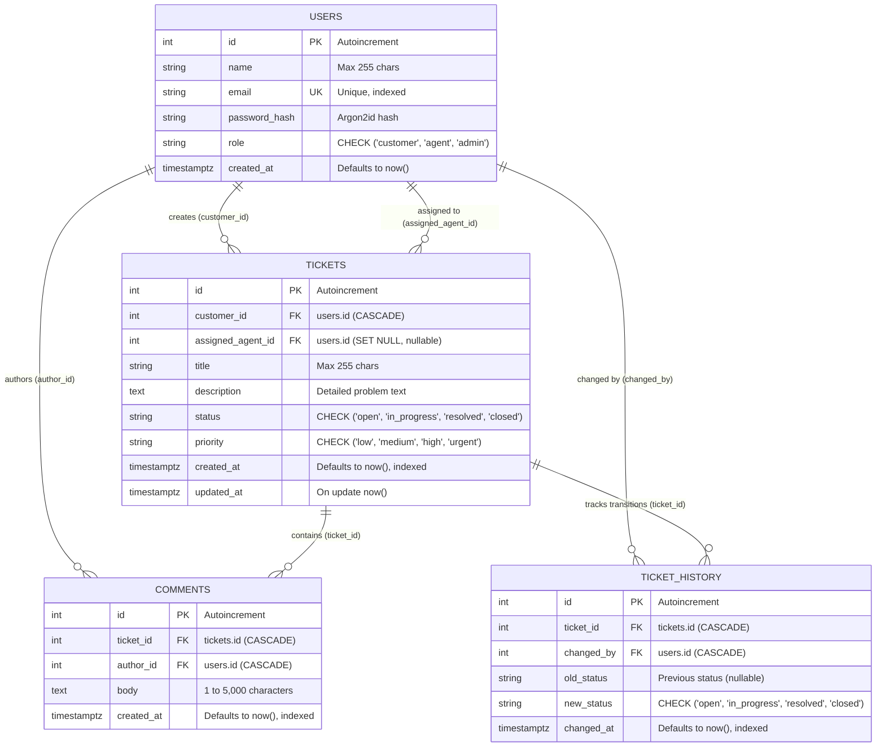

# Customer Support Ticket Management System

Production-ready backend service for a Customer Support Ticket Management System built with **FastAPI**, **PostgreSQL**, **SQLAlchemy 2.0**, **Alembic**, **Pydantic v2**, and **Pytest**.

---

## 1. Project Overview & Architecture

The application is structured following Clean Architecture principles with strong separation of concerns:
- **API Routing Layer (`app/api/`)**: Defines HTTP routes, response models, status codes, and security dependency injections.
- **Data & ORM Layer (`app/models/`)**: SQLAlchemy 2.0 declarative models defining tables, check constraints, foreign keys, cascades, indexes, and relationships.
- **Validation & Serialization Layer (`app/schemas/`)**: Pydantic v2 schemas providing runtime input validation, sanitized output representations, and OpenAPI schema examples.
- **Business Logic Layer (`app/services/`)**: Encapsulates atomic business logic, transactions, status transition auditing, and database-side aggregations.
- **Core Configuration & Security (`app/core/`)**: Pydantic Settings with strict validation (disallowing in-memory or SQLite fallbacks), Argon2id password hashing, and JWT token management.
- **Database Engine & Migrations (`app/database/`, `alembic/`)**: Thread-safe SQLAlchemy session handling, engine pooling, and versioned Alembic schema migrations.

```text
d:\task1\
├── alembic\                       # Database migration management
│   ├── env.py                     # Alembic migration environment
│   ├── script.py.mako             # Autogeneration script template
│   └── versions\                  # Version migration scripts
│       └── 86d5d08a7600_create_initial_tables.py
├── app\
│   ├── api\                       # FastAPI routes and dependencies
│   │   ├── deps.py                # Database sessions and RBAC dependencies
│   │   └── v1\
│   │       ├── router.py          # Master v1 API router
│   │       └── endpoints\
│   │           ├── health.py      # Health checks (/health)
│   │           ├── auth.py        # Authentication & registration (/auth)
│   │           ├── tickets.py     # Core ticket management (/tickets)
│   │           └── analytics.py   # Status counts & agent ranking (/analytics)
│   ├── cli.py                     # Administrative CLI for user creation and bootstrapping
│   ├── core\                      # Core configuration and security
│   │   ├── config.py              # Pydantic Settings with PostgreSQL validation
│   │   └── security.py            # Argon2 password hashing & JWT token issuance
│   ├── database\                  # Database engine and sessions
│   │   ├── base.py                # Base metadata aggregating all ORM entities
│   │   └── session.py             # Engine, sessionmaker, and connectivity utilities
│   ├── models\                    # SQLAlchemy 2.0 ORM models
│   │   ├── base.py                # DeclarativeBase with standardized naming convention
│   │   ├── enums.py               # UserRole, TicketStatus, TicketPriority enums
│   │   ├── user.py                # User model with role constraints
│   │   ├── ticket.py              # Ticket model with status & priority constraints
│   │   ├── comment.py             # Comment model with ticket and author FKs
│   │   └── ticket_history.py      # TicketHistory audit log model
│   ├── schemas\                   # Pydantic v2 validation & serialization schemas
│   │   ├── enums.py               # Enums re-exported for Pydantic
│   │   ├── health.py              # HealthCheckResponse schema
│   │   ├── user.py                # User schemas (CustomerRegister, Login, Token, Read)
│   │   ├── ticket.py              # Ticket schemas (Create, Update, Assign, Read, Paginated)
│   │   ├── comment.py             # Comment schemas (Create, Read, Paginated)
│   │   ├── ticket_history.py      # TicketHistoryRead & Paginated schemas
│   │   └── analytics.py           # TicketStatusCountsResponse & AgentUnresolvedTickets schemas
│   ├── services\                  # Domain business logic and transactions
│   │   ├── base.py                # Generic CRUD base service
│   │   ├── user.py                # User registration & authentication service
│   │   ├── ticket.py              # Atomic ticket creation, filtering, update & assignment
│   │   ├── comment.py             # Comment creation, access control & history listing
│   │   └── analytics.py           # Database-side aggregations for status counts & agent ranking
│   └── main.py                    # FastAPI application factory and route aliases
├── docs\                          # Documentation assets
│   └── er-diagram.md              # Entity-Relationship diagram and schema constraints
├── postman\                       # Postman test collection and environment
│   ├── customer_support_ticket_api.postman_collection.json
│   └── local_environment.postman_environment.json
├── sql\                           # Standalone SQL analytics and reporting queries
│   └── analytics.sql              # Parameterized queries for filtering, counts & agent ranking
├── tests\                         # Pytest test suite (89 passing tests)
│   ├── conftest.py                # PostgreSQL test fixtures and isolated transactions
│   ├── test_analytics.py          # Analytics endpoints, empty DBs, zero-ticket agents & ranking tests
│   ├── test_auth.py               # Auth, registration, Argon2, JWT, RBAC & CLI tests
│   ├── test_comments.py           # Comments, chronological order, permissions & history tests
│   ├── test_config.py             # Settings validation & SQLite/in-memory rejection
│   ├── test_database.py           # Live PostgreSQL connectivity & session lifecycle
│   ├── test_health.py             # Health check endpoints under normal & degraded states
│   ├── test_integration_workflows.py # E2E customer, agent, admin workflows & error handling
│   ├── test_models.py             # Model constraints, indexes, FKs, cascades
│   └── test_tickets.py            # Core ticket CRUD, RBAC, ownership, filters, pagination, assignment
├── .env                           # Local environment configuration (git-ignored)
├── .env.example                   # Template environment variables (no real secrets)
├── .gitignore                     # Git ignore rules
├── alembic.ini                    # Alembic configuration
├── requirements.txt               # Pinned dependency specifications
└── README.md                      # Comprehensive documentation
```

---

## 2. Prerequisites & Installation

### Prerequisites
- Python 3.10+ (tested with Python 3.12.10)
- PostgreSQL 14+ (tested with PostgreSQL 18 on localhost:5432)
- Virtual environment (`venv` or `virtualenv`)

### Installation Steps
```bash
# 1. Clone repository and navigate to project root
cd d:\task1

# 2. Create and activate a Python virtual environment
python -m venv .venv

# On Windows PowerShell:
.venv\Scripts\Activate.ps1
# On Linux / macOS:
source .venv/bin/activate

# 3. Install dependencies
pip install -r requirements.txt
```

---

## 3. Environment Variable Configuration

Create a `.env` file in the project root by copying `.env.example`:
```bash
copy .env.example .env  # Windows
cp .env.example .env    # Linux/macOS
```

### Configuration Variables

| Variable | Type | Default | Description |
|---|---|---|---|
| `ENVIRONMENT` | string | `development` | Environment mode (`development`, `staging`, `production`) |
| `PROJECT_NAME` | string | `Customer Support Ticket Management System` | Project application name |
| `API_V1_STR` | string | `/api/v1` | URL prefix for version 1 API endpoints |
| `POSTGRES_SERVER` | string | `localhost` | PostgreSQL host address |
| `POSTGRES_PORT` | integer | `5432` | PostgreSQL port |
| `POSTGRES_USER` | string | `postgres` | PostgreSQL username |
| `POSTGRES_PASSWORD` | string | *(required)* | PostgreSQL user password |
| `POSTGRES_DB` | string | `support_ticket_db` | Primary application database name |
| `POSTGRES_TEST_DB`| string | `support_ticket_test` | Dedicated isolated test database name |
| `DATABASE_URL` | string | *(optional)* | Direct connection string; overrides separate `POSTGRES_*` settings |
| `SECRET_KEY` | string | *(required)* | Cryptographic key for signing JWT tokens |
| `ACCESS_TOKEN_EXPIRE_MINUTES` | integer | `60` | JWT token lifetime in minutes |

> **Security Note**: In-memory and SQLite databases are strictly forbidden by `app/core/config.py`. The application will raise a startup validation error if an in-memory or SQLite connection URL is provided.

---

## 4. Database Setup & Migrations

Ensure your PostgreSQL instance is running and the database exists:
```sql
CREATE DATABASE support_ticket_db;
CREATE DATABASE support_ticket_test;
```

Run Alembic migrations to apply all tables, constraints, foreign keys, and indexes:
```bash
# Apply migrations to head
alembic upgrade head

# Verify current database revision
alembic current
```

---

## 5. Administrative CLI & Bootstrapping

The application provides a CLI (`python -m app.cli`) for managing users and bootstrapping administrative access safely without exposing public admin registration endpoints.

### Commands

```bash
# Bootstrap the initial administrator (idempotent; safe to run on startup)
python -m app.cli bootstrap-admin --email "admin@example.com" --password "StrongAdminPass123!"

# Create an administrator
python -m app.cli create-user --name "System Admin" --email "admin2@example.com" --role admin --password "SecurePass123!"

# Create a support agent
python -m app.cli create-user --name "Support Agent 1" --email "agent1@example.com" --role agent --password "SecurePass123!"
```

---

## 6. Server Startup

Start the FastAPI application with Uvicorn:
```bash
uvicorn app.main:app --host 0.0.0.0 --port 8000 --reload
```

### Interactive Documentation & Health Endpoints
- **Swagger UI**: [http://localhost:8000/docs](http://localhost:8000/docs) (also aliased at `/api/v1/docs`)
- **OpenAPI 3.1.0 Specification**: [http://localhost:8000/openapi.json](http://localhost:8000/openapi.json)
- **ReDoc UI**: [http://localhost:8000/redoc](http://localhost:8000/redoc)
- **Health Check**: [http://localhost:8000/health](http://localhost:8000/health)

---

## 7. API Endpoints & Request/Response Examples

Endpoints are accessible both via `/api/v1/...` and direct root aliases (`/tickets`, `/analytics`).

### Endpoint Summary

| Method | Endpoint | Access | Description | Status Codes |
|---|---|---|---|---|
| `POST` | `/api/v1/auth/register` | Public | Register customer account. Role is strictly assigned to `customer`. | `201`, `409`, `422` |
| `POST` | `/api/v1/auth/login` | Public | Authenticate with email/password; returns JWT access token. | `200`, `401`, `422` |
| `GET` | `/api/v1/auth/me` | Authenticated | Retrieve authenticated user profile (never returns password hashes). | `200`, `401` |
| `POST` | `/api/v1/tickets` | Authenticated | Create a ticket (customer owns ticket; status initialized to `open`). | `201`, `401`, `422` |
| `GET` | `/api/v1/tickets` | Authenticated | List tickets with filtering & pagination (scoped by user role). | `200`, `401`, `403`, `422` |
| `GET` | `/api/v1/tickets/{id}` | Authenticated | Retrieve ticket details (enforces ownership access control). | `200`, `401`, `403`, `404` |
| `PATCH` | `/api/v1/tickets/{id}` | Authenticated | Update permitted fields according to role allowlist. | `200`, `401`, `403`, `404`, `422` |
| `PATCH` | `/api/v1/tickets/{id}/assign` | Admin | Assign ticket to support agent (`role=agent`) or unassign (`null`). | `200`, `400`, `401`, `403`, `404`, `422` |
| `POST` | `/api/v1/tickets/{id}/comments` | Authenticated | Add comment. `author_id` is derived strictly from JWT token. | `201`, `401`, `403`, `404`, `422` |
| `GET` | `/api/v1/tickets/{id}/comments` | Authenticated | Retrieve comments in ascending chronological order with pagination. | `200`, `401`, `403`, `404`, `422` |
| `GET` | `/api/v1/tickets/{id}/history` | Authenticated | Retrieve status transition history audit log in chronological order. | `200`, `401`, `403`, `404`, `422` |
| `GET` | `/api/v1/analytics/tickets/status-counts` | Admin | Aggregate counts of tickets in each status (including zero counts). | `200`, `401`, `403` |
| `GET` | `/api/v1/analytics/agents/unresolved` | Admin | Rank agents by unresolved tickets (`open` + `in_progress`). | `200`, `401`, `403` |

---

### Key Request & Response Examples

#### 1. Customer Registration (`POST /api/v1/auth/register`)
**Request**:
```json
POST /api/v1/auth/register
Content-Type: application/json

{
  "name": "Alice Customer",
  "email": "alice@example.com",
  "password": "SecurePassword123!"
}
```
**Response (`201 Created`)**:
```json
{
  "id": 1,
  "name": "Alice Customer",
  "email": "alice@example.com",
  "role": "customer",
  "created_at": "2026-10-16T10:00:00Z"
}
```

#### 2. User Login (`POST /api/v1/auth/login`)
**Request**:
```json
POST /api/v1/auth/login
Content-Type: application/json

{
  "email": "alice@example.com",
  "password": "SecurePassword123!"
}
```
**Response (`200 OK`)**:
```json
{
  "access_token": "eyJhbGciOiJIUzI1NiIsInR5cCI6IkpXVCJ9...",
  "token_type": "bearer",
  "expires_in": 3600,
  "user": {
    "id": 1,
    "name": "Alice Customer",
    "email": "alice@example.com",
    "role": "customer",
    "created_at": "2026-10-16T10:00:00Z"
  }
}
```

#### 3. Create Ticket (`POST /api/v1/tickets`)
**Request**:
```json
POST /api/v1/tickets
Authorization: Bearer <customer_token>
Content-Type: application/json

{
  "title": "Cannot export analytics CSV",
  "description": "Receiving a 500 error when clicking the Export CSV button on Firefox.",
  "priority": "high"
}
```
**Response (`201 Created`)**:
```json
{
  "id": 101,
  "title": "Cannot export analytics CSV",
  "description": "Receiving a 500 error when clicking the Export CSV button on Firefox.",
  "priority": "high",
  "status": "open",
  "customer_id": 1,
  "assigned_agent_id": null,
  "created_at": "2026-10-16T10:05:00Z",
  "updated_at": "2026-10-16T10:05:00Z"
}
```

#### 4. Assign Ticket to Agent (`PATCH /api/v1/tickets/{id}/assign`)
**Request**:
```json
PATCH /api/v1/tickets/101/assign
Authorization: Bearer <admin_token>
Content-Type: application/json

{
  "assigned_agent_id": 2
}
```
**Response (`200 OK`)**:
```json
{
  "id": 101,
  "title": "Cannot export analytics CSV",
  "description": "Receiving a 500 error when clicking the Export CSV button on Firefox.",
  "priority": "high",
  "status": "open",
  "customer_id": 1,
  "assigned_agent_id": 2,
  "created_at": "2026-10-16T10:05:00Z",
  "updated_at": "2026-10-16T10:10:00Z"
}
```

#### 5. Add Comment (`POST /api/v1/tickets/{id}/comments`)
**Request**:
```json
POST /api/v1/tickets/101/comments
Authorization: Bearer <customer_token>
Content-Type: application/json

{
  "body": "Here is the error console screenshot: TypeError at export.js line 42."
}
```
**Response (`201 Created`)**:
```json
{
  "id": 501,
  "ticket_id": 101,
  "author_id": 1,
  "body": "Here is the error console screenshot: TypeError at export.js line 42.",
  "created_at": "2026-10-16T10:15:00Z"
}
```

#### 6. Ticket Status Counts (`GET /api/v1/analytics/tickets/status-counts`)
**Request**:
```bash
GET /api/v1/analytics/tickets/status-counts
Authorization: Bearer <admin_token>
```
**Response (`200 OK`)**:
```json
{
  "open": 3,
  "in_progress": 2,
  "resolved": 10,
  "closed": 0,
  "total": 15,
  "counts": {
    "open": 3,
    "in_progress": 2,
    "resolved": 10,
    "closed": 0
  },
  "status_counts": {
    "open": 3,
    "in_progress": 2,
    "resolved": 10,
    "closed": 0
  }
}
```

#### 7. Ranked Agents by Unresolved Workload (`GET /api/v1/analytics/agents/unresolved`)
**Request**:
```bash
GET /api/v1/analytics/agents/unresolved
Authorization: Bearer <admin_token>
```
**Response (`200 OK`)**:
```json
[
  {
    "agent_id": 2,
    "id": 2,
    "name": "Sarah Support",
    "email": "sarah.support@example.com",
    "unresolved_count": 5,
    "open_count": 3,
    "in_progress_count": 2
  },
  {
    "agent_id": 3,
    "id": 3,
    "name": "Bob Support",
    "email": "bob.support@example.com",
    "unresolved_count": 0,
    "open_count": 0,
    "in_progress_count": 0
  }
]
```

---

## 8. Role-Based Access Control (RBAC) & Security Rules

### Permissions Matrix

| Operation | Customer | Agent | Admin |
|---|---|---|---|
| Register Customer | Public | Public | Public |
| Login / Get Token | Public | Public | Public |
| View Own Profile (`/auth/me`) | Yes | Yes | Yes |
| Create Ticket | Yes (for self) | Yes | Yes |
| View Tickets | Own tickets only | Assigned tickets only | All tickets |
| Filter by Customer / Agent | Forbidden (`403`) | Forbidden (`403`) | Permitted |
| Update Title / Description | Permitted | Permitted | Permitted |
| Update Status / Priority | Forbidden (`403`) | Permitted | Permitted |
| Assign Ticket to Agent | Forbidden (`403`) | Forbidden (`403`) | Permitted |
| Add Comment | Own tickets only | Assigned tickets only | Any ticket |
| View Comments & History | Own tickets only | Assigned tickets only | Any ticket |
| Analytics Endpoints | Forbidden (`403`) | Forbidden (`403`) | Permitted |

### Security Guarantees
1. **Password Storage**: Passwords are securely hashed with **Argon2id** (`argon2-cffi`) using cryptographically secure salts. Raw passwords and hashes are never exposed in API responses.
2. **Untrusted Author ID**: `author_id` is never accepted in request bodies; it is strictly derived from the validated JWT token (`current_user.id`).
3. **Guessed Ticket ID Protection**: Attempting to access a non-existent ticket ID returns `404 Not Found`; attempting to access an existing ticket without ownership authorization returns `403 Forbidden`.
4. **Sanitized Error Responses**: A global exception handler in `app/main.py` intercepts unexpected exceptions, returning `{"detail": "..."}` with status 500 while preventing leakage of internal tracebacks, SQL statements, or database credentials.
5. **No String Interpolation SQL**: All database operations and raw queries use parameterized bindings (`:param`), completely eliminating SQL injection risks.

---

## 9. Database Entity-Relationship (ER) Diagram



Detailed database constraints, cascades, and indexes are documented in [`docs/er-diagram.md`](file:///d:/task1/docs/er-diagram.md).

---

## 10. Standalone SQL Reporting (`sql/analytics.sql`)

The repository includes [`sql/analytics.sql`](file:///d:/task1/sql/analytics.sql) with production-ready PostgreSQL queries:
1. **Query 1 (Ticket Retrieval & Filtering)**: Parameterized filtering by status, priority, customer, assigned agent, creation date range, and text search with deterministic ordering and `LIMIT`/`OFFSET` pagination.
2. **Query 2 (Ticket Status Counts)**: Uses a CTE of all four supported statuses with a `LEFT JOIN` on `tickets`, guaranteeing that all statuses (including zero-ticket statuses) are returned.
3. **Query 3 (Agent Workload Ranking)**: Ranks agents by unresolved assigned tickets (`status IN ('open', 'in_progress')`). The status condition is placed in the `LEFT JOIN ... ON` clause rather than `WHERE` to preserve agents with zero unresolved tickets with count = 0.
4. **Performance Indexes**: Documents recommended B-tree and composite partial indexes, including `ix_tickets_agent_unresolved` on `(assigned_agent_id, status) WHERE status IN ('open', 'in_progress')`.

---

## 11. Postman API Collection

- **Collection**: [`postman/customer_support_ticket_api.postman_collection.json`](file:///d:/task1/postman/customer_support_ticket_api.postman_collection.json)
- **Environment**: [`postman/local_environment.postman_environment.json`](file:///d:/task1/postman/local_environment.postman_environment.json)

### Usage:
1. Open Postman $\rightarrow$ Click **Import** $\rightarrow$ Select both collection and environment files.
2. Set the active environment to **Local Support Ticket Environment**.
3. Run the requests sequentially. Authentication requests automatically extract and store JWT tokens into collection variables (`customer_token`, `agent_token`, `admin_token`) for subsequent requests.

---

## 12. Automated Testing & Verification

The test suite runs against the dedicated test database (`support_ticket_test`). Each test function executes within a database connection with an isolated transaction that is rolled back upon test completion, ensuring tests are completely non-destructive and independent.

### Running Tests
```bash
# Run all tests with verbose output
pytest -v

# Run with summary
pytest -q

# Run specific test modules
pytest tests/test_integration_workflows.py -v
pytest tests/test_analytics.py -v
pytest tests/test_tickets.py -v
pytest tests/test_comments.py -v
pytest tests/test_auth.py -v
```

### Actual Test Suite Results
```text
============================= test session starts =============================
platform win32 -- Python 3.12.10, pytest-9.1.1, pluggy-1.7.0 -- D:\task1\.venv\Scripts\python.exe
rootdir: D:\task1
plugins: anyio-4.15.1
collected 89 items

tests/test_analytics.py .........                                        [ 10%]
tests/test_auth.py ....................                                  [ 32%]
tests/test_comments.py ...........                                       [ 44%]
tests/test_config.py .....                                               [ 50%]
tests/test_database.py ...                                               [ 53%]
tests/test_health.py ...                                                 [ 57%]
tests/test_integration_workflows.py ......                               [ 64%]
tests/test_models.py ............                                        [ 77%]
tests/test_tickets.py ....................                               [100%]

======================== 89 passed, 1 warning in 9.33s ========================
```

---

## 13. Production Deployment Guide

### Deployment Architecture
- **Process Manager**: Run Gunicorn with Uvicorn worker classes (`uvicorn.workers.UvicornWorker`).
- **Reverse Proxy**: Place an Nginx or Caddy reverse proxy in front of Gunicorn to handle SSL/TLS termination, request rate-limiting, and compression.
- **Database Connection Pooling**: Tune `pool_size` and `max_overflow` in `app/database/session.py` according to expected concurrency and database connection limits.

### Production Startup Command
```bash
# Production multi-worker start (Linux / Container)
gunicorn app.main:app \
  --workers 4 \
  --worker-class uvicorn.workers.UvicornWorker \
  --bind 0.0.0.0:8000 \
  --access-logfile - \
  --error-logfile -
```

### Pre-Deployment Migration Command
In CI/CD deployment pipelines, run migrations prior to routing traffic to new application instances:
```bash
alembic upgrade head
```
