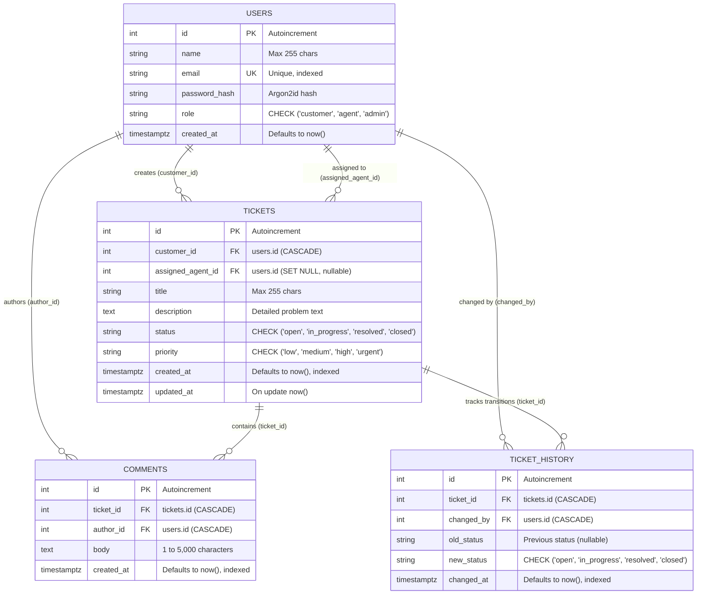

# Database Entity-Relationship (ER) Diagram

This document illustrates the data model and schema relationships for the Customer Support Ticket Management System.

---

## Key Constraints and Indexes

1. **User Constraints**:
   - `users.email`: Unique constraint and B-Tree index.
   - `users.role`: Check constraint `role IN ('customer', 'agent', 'admin')` and B-Tree index.

2. **Ticket Constraints & Cascades**:
   - `tickets.customer_id`: Foreign key referencing `users.id` with `ON DELETE CASCADE`.
   - `tickets.assigned_agent_id`: Foreign key referencing `users.id` with `ON DELETE SET NULL`.
   - `tickets.status`: Check constraint `status IN ('open', 'in_progress', 'resolved', 'closed')` and B-Tree index.
   - `tickets.priority`: Check constraint `priority IN ('low', 'medium', 'high', 'urgent')` and B-Tree index.
   - Composite partial index: `(assigned_agent_id, status) WHERE status IN ('open', 'in_progress')` for agent workload analytics.

3. **Comment Constraints**:
   - `comments.ticket_id`: Foreign key referencing `tickets.id` with `ON DELETE CASCADE`.
   - `comments.author_id`: Foreign key referencing `users.id` with `ON DELETE CASCADE`.
   - Chronological ordering index: `created_at ASC, id ASC`.

4. **Ticket History Constraints**:
   - `ticket_history.ticket_id`: Foreign key referencing `tickets.id` with `ON DELETE CASCADE`.
   - `ticket_history.changed_by`: Foreign key referencing `users.id` with `ON DELETE CASCADE`.
   - `ticket_history.new_status`: Check constraint `new_status IN ('open', 'in_progress', 'resolved', 'closed')`.
   - Audit ordering index: `changed_at ASC, id ASC`.
